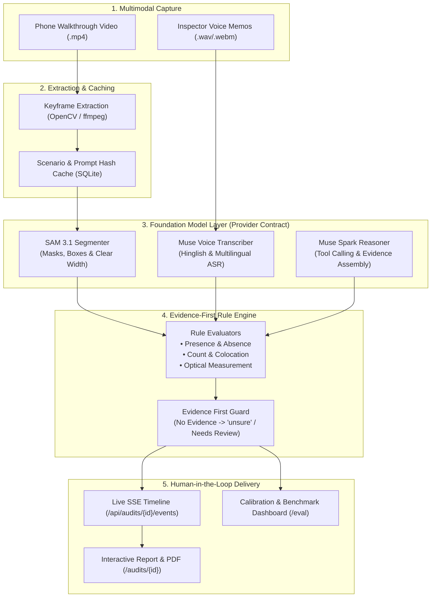

# AuditLens

> **Walk through. Get proof. Fix what matters.**  
> An assistive safety pre-audit tool powered by foundation models.

Upload a phone walkthrough video or photos of a room, workshop, or lab. Choose a safety checklist or type your own rule. Receive an evidence-backed audit report with synchronized bounding-box overlays, optical clearance width measurements, confidence scores, and plain-language fixes.

**⚠️ Disclaimer:** AuditLens is an assistive pre-audit tool. It does not certify legal compliance. Always verify against local regulations and a qualified inspector.

---

## 🚀 Quick Start (Local Development)

### Prerequisites
- Python 3.11+
- Node.js 18+
- `ffmpeg` (`brew install ffmpeg` on macOS, or `apt-get install ffmpeg` on Linux)

```bash
# 1. Setup Python venv and install frontend dependencies
make setup

# 2. Start backend (:8000) and frontend (:5173) concurrently
make dev
```

Open [http://localhost:5173](http://localhost:5173) in your browser.

- Click **"Load Demo Audit (Demo Data)"** on the top right to run an end-to-end audit with the pre-generated synthetic video in 1 click without uploading any files.

---

## 🛠️ CLI Runner & Evaluation Benchmark

AuditLens can run completely headless from the command line:

```bash
# Generate the synthetic 25-second walkthrough video
make sample-video

# Run full audit from terminal with live event timeline & findings table
backend/.venv/bin/python backend/scripts/run_audit_cli.py --video data/sample_walkthrough.mp4 --template fire_exit_safety

# Run the Precision & Recall evaluation benchmark suite (comparing baseline vs full pipeline)
backend/.venv/bin/python eval/run_eval.py --mode both
```

---

## 🧪 Testing

```bash
# Run all 61 backend pytest tests (rules, cache, cost, evidence-first, API, replay, eval metrics)
make test

# Run frontend unit tests (letterbox coordinate projection, formatters, models used panel)
cd frontend && npm test

# TypeScript typecheck & production build
make lint
cd frontend && npm run build
```

---

## 🐳 Production Deployment & Hosting

### Option A: Docker Compose (Quickest)

```bash
docker compose up --build
```
Mounts `./data` to `/data` with persistent SQLite and file uploads, and configures `CORS_ORIGINS=*`.

### Option B: Docker Container

AuditLens includes a production-ready `Dockerfile` with `ffmpeg` and OpenCV native libraries pre-installed.

```bash
# Build Docker container
docker build -t auditlens-backend -f backend/Dockerfile backend/

# Run container with persistent data volume mounted
docker run -d \
  -p 8000:8000 \
  -v $(pwd)/data:/data \
  -e CORS_ORIGINS="https://yourdomain.com,http://localhost:5173" \
  -e PROVIDER_MODE=mock \
  --name auditlens-api \
  auditlens-backend
```

### Option C: Demo Recording & Offline Replay Fallback

For reliable offline demonstrations or environments where live AI APIs cannot be reached:

```bash
# Record an audit run to data/fixtures/demo_recording.json
make record-demo

# Run backend with DEMO_REPLAY=1 to replay recorded events with realistic timing
DEMO_REPLAY=1 make backend
```
> [!IMPORTANT]
> The UI explicitly tags replayed executions with a prominent **"Recorded run"** badge. Replay is strictly a fallback and is never presented as live.

### Option B: Reverse Proxy Configuration (Nginx & SSE)

When running behind an Nginx or Cloudflare reverse proxy, disable response buffering so Server-Sent Events (SSE) stream in real time without lag:

```nginx
location /api/audits/ {
    proxy_pass http://127.0.0.1:8000;
    proxy_set_header Host $host;
    proxy_set_header X-Real-IP $remote_addr;

    # Critical SSE proxy directives
    proxy_set_header Connection '';
    proxy_http_version 1.1;
    chunked_transfer_encoding off;
    proxy_buffering off;
    proxy_cache off;
    proxy_read_timeout 300s;
}
```

---

## 🏆 What was built during the hackathon (Oct 26 - Nov 4)

AuditLens was architected and built from scratch during the hackathon window as a complete end-to-end safety pre-audit system:

1. **Provider Discipline & Foundation Model Contracts** (`backend/app/providers/`):
   - Strict typed abstract base classes: `Segmenter` (`SAM 3.1`), `Reasoner` (`Muse Spark`), and `Transcriber` (`Muse Voice Transcribe`).
   - Drop-in `Meta` provider stubs raising clear `NotImplementedError("TODO(meta)...")` pointing to `docs/META_INTEGRATION.md` for live API enablement without changing a single line of business logic.
   - Built-in Record/Replay proxy: records live model responses to `data/fixtures/<hash>.json` and replays them deterministically with zero network calls and realistic timing.
   - Secure config: `MODEL_API_KEY` read strictly from the environment; never logged, exposed via health endpoints, or checked into git.
2. **Deterministic Evidence-First Rule Engine** (`backend/app/rules/`):
   - 5 core rule evaluators: Presence, Absence, Count, Colocation, and Optical Measurement.
   - **Evidence First Contract:** All findings must originate from measured tool evidence with recorded uncertainty; ungrounded assertions strictly default to `unsure` ("Needs Review").
   - Hero scenario templates for workplace safety, college lab safety, and hostel fire safety specifying required detectors and evidence types.
3. **Voice Notes & Audio Grounding**:
   - MediaRecorder voice note recording in browser and audio upload endpoint.
   - Synchronized transcription timestamp matching findings within ±5 seconds with audio playback.
4. **Interactive Review & Verification UI** (`frontend/`):
   - Synchronized HTML5 video player with canvas bounding box overlays, letterbox coordinate transformation, and timestamp markers.
   - Before/after audit comparison view (`/compare`) tracking resolved vs new violations.
   - Transparent "Models Used" panel exposing model IDs, provider mode, cost, call count, and uncertainty disclaimers.
   - Exportable print & PDF report.
5. **Evaluation, Calibration & Ground-Truth Tooling** (`eval/` & `/eval`):
   - Keyframe ground-truth labeling CLI (`eval/label_cli.py` & `backend/scripts/label_keyframes.py`).
   - Benchmark evaluation harness (`eval/run_eval.py`) comparing Full Pipeline vs Direct Chat Vision Baseline.
   - Empirical Precision, Recall, F1, Confusion Matrices, and "Needs Review" Abstain Calibration curves.
   - Interactive `/eval` calibration dashboard displaying Reliability (confidence vs accuracy) and Abstain vs Accuracy tradeoff curves.

---

## 🏛️ System Architecture



```
+---------------------------------------------------------------------------------------------------+
|                                      AUDITLENS ARCHITECTURE                                       |
+---------------------------------------------------------------------------------------------------+
|  [Phone Video / Voice Memos] ---> [Keyframe Sampling (1 fps)] + [Scenario Cache (SQLite)]         |
|                                                     |                                             |
|                                                     v                                             |
|  [FOUNDATION MODEL CONTRACTS]                                                                     |
|    - SAM 3.1: Segmenter (prompts -> bounding boxes, masks, optical width)                         |
|    - Muse Spark: Reasoner (rule + visual evidence -> structured verdict)                          |
|    - Muse Voice: Transcriber (voice notes -> timestamped transcript turns)                        |
|                                                     |                                             |
|                                                     v                                             |
|  [EVIDENCE-FIRST RULE ENGINE]                                                                     |
|    - Five Rule Evaluators (Presence, Absence, Count, Colocation, Measurement)                     |
|    - Evidence Guard: Findings require tool measurements; missing evidence -> "unsure"            |
|                                                     |                                             |
|                                                     v                                             |
|  [DELIVERY & CALIBRATION]                                                                         |
|    - Real-time Server-Sent Events (SSE) Agent Timeline                                            |
|    - Interactive Video Player with Responsive Letterbox Overlays & PDF Export                     |
|    - Evaluation Harness: Precision/Recall/F1 + Reliability & Abstain Calibration (/eval)          |
+---------------------------------------------------------------------------------------------------+
```

---


## 📄 Makefile Commands

| Command | Description |
|---|---|
| `make setup` | Create virtualenv, install pip & npm packages, setup `.env` |
| `make dev` | Start backend (:8000) and frontend (:5173) concurrently |
| `make test` | Run all 61 backend pytest unit, smoke, replay, and calibration tests |
| `make lint` | Run TypeScript typecheck (`tsc --noEmit`) |
| `make sample-video` | Generate the 25-second synthetic walkthrough video |
| `make record-demo` | Capture completed audit events & findings to fixtures |
| `make clean` | Remove `.venv`, `node_modules`, and local build artifacts |

---

## ⚖️ License & Hackathon Context

Built for the **Meta Global AI Developer Hackathon**.
Assisting workplace facility managers and lab technicians perform rapid pre-audits between official inspections.
